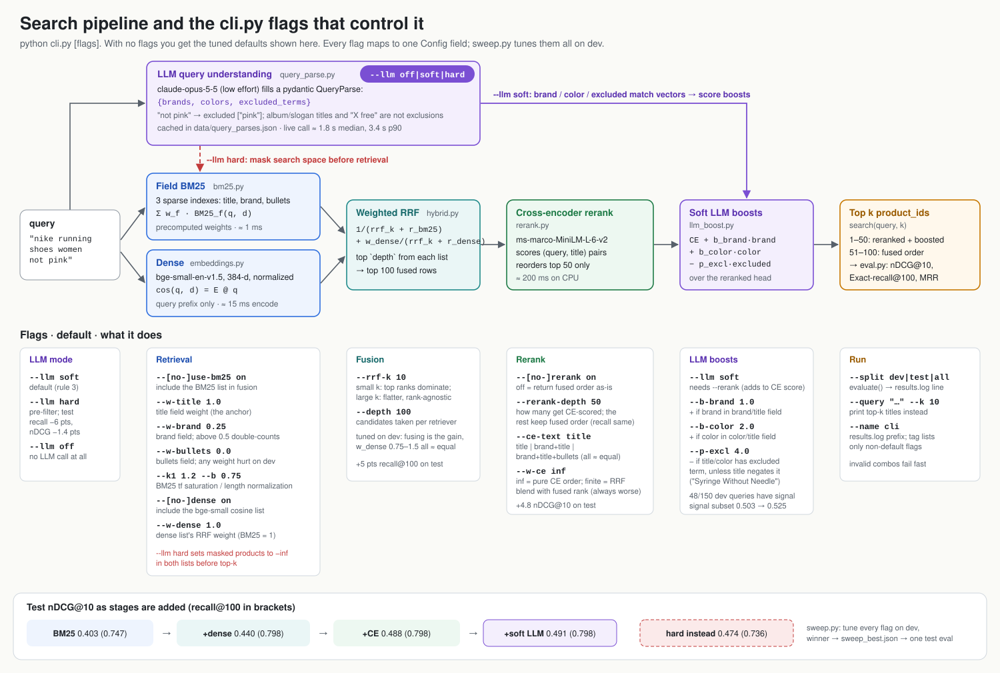

# Product search: field BM25 + dense RRF + cross-encoder + soft LLM signals

Search over an Amazon ESCI sample (36,984 products, 300 queries, graded E/S/C/I labels).
Results, per-stage write-up and next steps are in [NOTES.md](NOTES.md); the brief is [task.md](task.md).



## Setup

```bash
uv sync
python setup_data.py      # data/products.parquet, queries.csv, qrels.csv (csvs are committed)
python embeddings.py      # data/product_embeddings.npz (~7-14 min on CPU)
```

The LLM stage needs `ANTHROPIC_API_TOKEN` in `.env`. Query parses for the 300 eval queries are
committed in `data/query_parses.json`, so evaluation doesn't call the API.

## Run

Each stage is runnable on its own and logs dev + test to `results.log`:

```bash
python bm25.py          # field-weighted BM25, tunes field weights on dev
python hybrid.py        # + dense retriever via weighted RRF
python rerank.py        # + cross-encoder rerank of the top 50
python query_parse.py   # LLM -> pydantic QueryParse for every query (cached)
python llm_boost.py     # + soft LLM boosts, and the hard pre-filter comparison
```

`cli.py` exposes every component as a flag (`python cli.py --help`); `sweep.py` tunes all of them
on dev and evaluates the winner once on test.

```bash
python cli.py --split test --llm hard
python cli.py --query "nike running shoes women not pink"
```

| File | What it is |
|---|---|
| `split.py` | fixed seeded 150/150 dev/test split |
| `eval.py` | provided harness (unchanged) |
| `bm25_explained.svg` | how the sparse BM25 index works |
| `sweep_log.txt`, `sweep_best.json` | the full-config sweep run |
