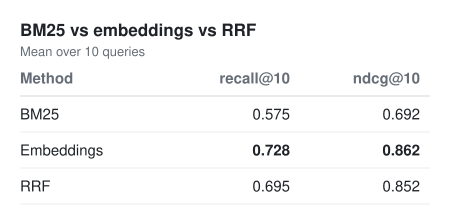

# Job posting search

Keyword search, semantic search and hybrid search over LinkedIn job postings, with an evaluation comparing the three.

Data: [`xanderios/linkedin-job-postings`](https://huggingface.co/datasets/xanderios/linkedin-job-postings) on Hugging Face (33,246 postings).

## Setup

```sh
uv sync
```

`evaluate.py` labels results with Claude, so it needs an API key in `.env`:

```
ANTHROPIC_API_TOKEN=sk-ant-...
```

(`ANTHROPIC_API_KEY` works too.)

## Pipeline

Run these in order. Each step saves its output, so later steps don't redo earlier work.

| Step | Command | Output |
|---|---|---|
| 1. Preprocess | `uv run preprocessing.py` | `data-with-text.csv` |
| 2. Embed | `uv run embed_search.py` | `embeddings.npy`, `data-subset.csv` |
| 3. Evaluate | `uv run evaluate.py` | `labels.json`, `results.svg` |

### 1. Preprocessing (`preprocessing.py`)

- Loads the dataset and converts the time columns from epoch milliseconds to dates.
- Builds a `text` column for search: `<title> in <location>. Description: <first 1000 chars of description>`. `company_id` is left out because it's a number with no company name attached.
- Drops postings whose `text` repeats an earlier one (545 reposts), leaving 32,701.

### 2. Search methods

All three print the top 20 results. Pass a query as an argument, or run with no arguments for an interactive prompt.

- **BM25** (`bm25_search.py`): keyword search. Tokenizes with `text.lower().split()`, builds `BM25Okapi`, and takes the top 20 scores with `np.argsort`. It runs on all 32,701 postings.
- **Embeddings** (`embed_search.py`): semantic search with `SentenceTransformer("all-MiniLM-L6-v2")`. Vectors are normalized, so cosine similarity is just `doc_embs @ query_emb`.
  - To keep testing fast, it embeds only the first 5,000 postings (`N_DOCS`, about 2 minutes on CPU; set it to `None` for all of them).
  - It saves those exact rows to `data-subset.csv`, and the embeddings are cached in `embeddings.npy`.
- **RRF** (`rrf.py`): hybrid search that combines the BM25 and embedding rankings with Reciprocal Rank Fusion. Each posting scores `1/(60 + bm25_rank) + 1/(60 + emb_rank)`. It runs on `data-subset.csv`.

`main.py` is a separate interactive explorer for the data: column overview, value counts, text search, filters and salary stats.

### 3. Evaluation (`evaluate.py`)

1. **Queries:** 10 test queries written by looking through the 5,000-row subset, so each one has real matches.
   - 7 are *keyword* queries that use words a posting would contain, e.g. "CDL truck driver".
   - 3 are *natural-language* queries that describe the job in everyday words, e.g. "caring for pets at an animal hospital".
2. **Pooling:** for each query, the union of the top 10 from BM25, embeddings and RRF. That's 170 postings to label instead of 50,000.
3. **Labeling:** `claude-opus-5-5` marks each pooled posting relevant (1) or not (0), one request per query, using structured output.
   - Labels are cached in `labels.json`, so reruns only pay for new postings.
4. **Metrics:**
   - `recall_at_k`: the share of all known relevant postings that appear in the top k.
   - `ndcg_at_k`: binary-gain nDCG, which rewards putting relevant postings near the top.
   - Postings outside the pool count as not relevant.

## Results

Mean over the 10 queries, k = 10:

| Method | recall@10 | nDCG@10 | nDCG@10, keyword queries | nDCG@10, natural-language queries |
|---|---|---|---|---|
| BM25 | 0.575 | 0.692 | 0.862 | 0.294 |
| Embeddings | **0.728** | **0.862** | 0.876 | **0.829** |
| RRF | 0.695 | 0.852 | **0.954** | 0.614 |



- **Keyword queries:** RRF is best, since combining the two methods beats either one alone.
- **Natural-language queries:** BM25 nearly fails, because the postings share few words with the query. Embeddings handle them well. BM25's weak rankings pull RRF down here.
- **Caveats:** this is a small test. There are only 10 queries (3 natural-language), the subset is 5,000 postings, and the labels come from a model. I spot-checked them and they look reasonable, but a few seniority calls are debatable.

## Ideas for next steps

- Weighted RRF that gives embeddings more weight than BM25.
- A better BM25 tokenizer, e.g. `re.findall(r"\w+", text.lower())`, so punctuation like "python," doesn't block matches.
- More natural-language queries, and embedding all 32,701 postings.

## Notes

- The generated files (`data-with-text.csv`, `data-subset.csv`, `embeddings.npy`, `labels.json`) and `.env` are in `.gitignore`.
- On Windows, set `HF_HUB_DISABLE_SYMLINKS_WARNING=1` to hide a harmless Hugging Face warning.
